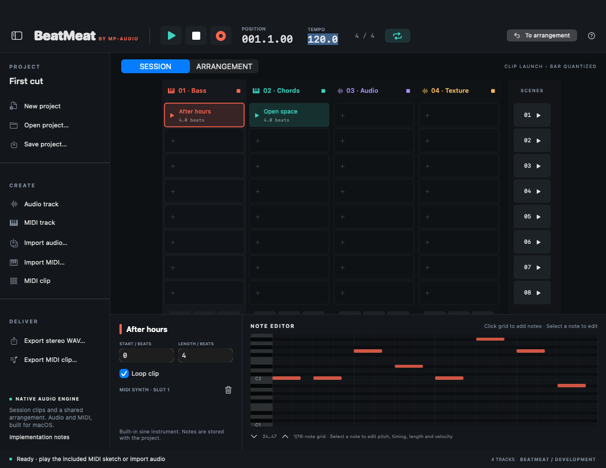

# BeatMeat by MP-Audio

Native macOS audio/MIDI workstation development preview, built from an independent engineering review of the supplied 534-page Ableton Live 8 manual. **This is an original, limited workstation implementation, not a feature-complete Live clone.**

[Download the v0.1.0-dev macOS preview](https://github.com/shaunroohi-alt/BeatMeat/releases/tag/v0.1.0-dev). The ZIP and DMG contain a universal Intel/Apple Silicon application for macOS 14 or newer. Extract the ZIP or mount the DMG, then copy `BeatMeat.app` into your Applications folder. This preview is ad-hoc signed and is not Apple notarized.

The source includes an original Session clip grid, Arrangement timeline, audio and MIDI tracks, piano-roll editing, scene/clip launch quantization, per-track Session overrides, a mixer, microphone recording path, save/open with collected audio, MIDI file interchange and offline WAV export. Demo notes are synthesized by the original sine instrument; no vendor sound library is included.

Read [feature coverage](Docs/FEATURE_COVERAGE.md) for the exact implemented subset and gaps, [the 32-chapter blueprint](Docs/MANUAL_BLUEPRINT.md) for every reference chapter, and the four detailed review reports for behavior specifications. The supplied manual is retained in `Docs/Reference_Manual.pdf`.



## Build and run from source

Requires macOS 14+, Xcode with command-line tools selected, and Python 3. No Apple team is needed for ad-hoc local development. The packaged preview above runs without Xcode.

```sh
./script/build_and_run.sh
```

Or open `BeatMeat.xcodeproj`, select the BeatMeat scheme and My Mac, and run. The script is also wired to the Codex Run action. Use `--verify`, `--logs`, `--telemetry`, or `--debug` for the corresponding diagnostics. It launches a native .app bundle, not a web app or raw GUI executable.

## Validate and package

```sh
bash scripts/test-dsp.sh     # 22 DSP/transport scenarios
swift test                   # 26 persistence and MIDI tests
bash scripts/package.sh      # Mac build, tests, native smoke, universal verification, signing, ZIP and DMG
bash scripts/install-macos.sh # Installs the built app into ~/Applications with an existing-app backup
```

The package script generates `dist/BeatMeat.app`, `BeatMeat-macOS.zip` and `BeatMeat-macOS.dmg` only after the build and required checks pass. The release page provides the packaged development preview; a source archive contains the project rather than a prebuilt app. The optional `BEATMEAT_SIGN_IDENTITY` selects an existing local signing identity. Ad-hoc signing is the default. Developer ID distribution and notarization are not configured.

## Using the preview

- Play the included two-track MIDI sketch. Session launches enter on the next 4-beat bar; scenes launch a row. Stopping a Session clip retains its override until Back to Arrangement.
- Add an Audio track or select the supplied one, then Import Audio. Full tracks are decoded into memory; use short unprotected stereo/mono audio. Loading and structural edits can interrupt playback.
- Select an empty slot on a MIDI track and create a MIDI clip. Click the piano roll to add notes; edit pitch, timing, duration and velocity below. Import/export standard MIDI via the menus.
- Arrangement clip placement and length use beats. Mixer changes affect the shared track; switching the visible view does not itself change audio ownership.
- Arm an Audio track, press Record and grant microphone access. Stop recording before editing or saving. Save the project to collect recorded/imported audio into its Media folder.
- Save/Open use `.beatmeat` project packages. WAV export renders Arrangement as 44.1 kHz stereo float audio, including mixer settings and a tail. It does not export transient Session ownership.

## Validation and release scope

The [successful macOS workflow](https://github.com/shaunroohi-alt/BeatMeat/actions/runs/40463701686) tested implementation commit `a69ac23c7bf810eaf378c1fae9e0c4cd7c0817f9`. It completed:

- A universal Intel/Apple Silicon macOS build, including Swift type checking and native linking.
- All 22 portable DSP/transport scenarios with strict warnings, AddressSanitizer and UndefinedBehaviorSanitizer.
- All 26 Swift tests: 17 project/persistence cases and 9 MIDI-file cases.
- Native save/open/overwrite, MIDI roundtrip and non-silent offline WAV-export smoke checks.
- A native window launch and screenshot, with the audio graph initialized.
- Architecture verification, ad-hoc signing verification, and ZIP/DMG packaging.

These checks establish the development preview's build and exercised paths. They do not establish complete manual parity, physical microphone recording, device latency, sustained real-time performance, or audible output on your speakers. Hardware recording and live-performance validation remain outstanding. The release is not notarized.

Read [feature coverage](Docs/FEATURE_COVERAGE.md) before relying on an advanced workflow. The full reference review is a roadmap; it does not make the missing devices, libraries, Warp modes, plug-in hosting, automation, video, racks or hardware integrations implemented.
